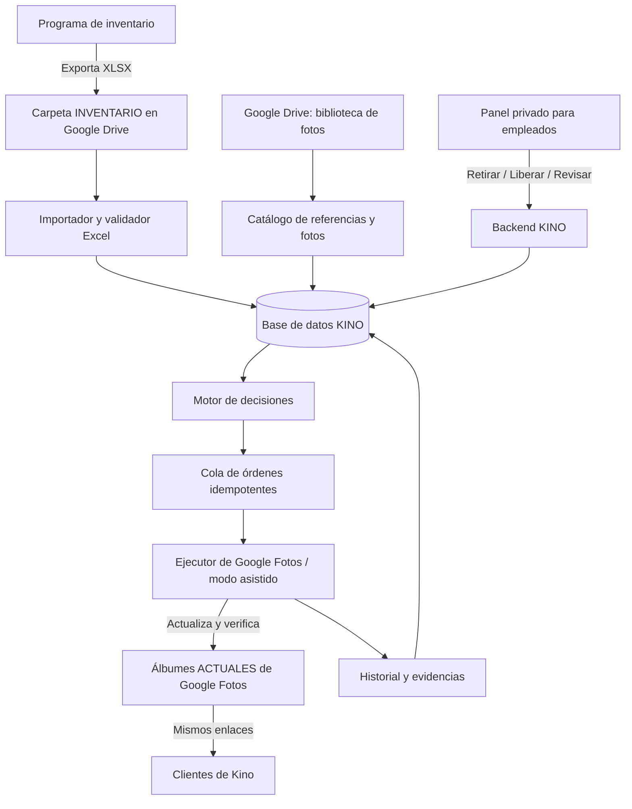

# KINO CATÁLOGO CONTROL

**Documento de arquitectura funcional y técnica — versión 1.0**  
**Empresa:** Kino Company S.A.S.  
**Fecha:** 6 de noviembre de 2026  
**Estado:** propuesta para validación y desarrollo; no es un sistema implementado.  
**Objetivo prioritario:** conservar **los mismos álbumes y enlaces compartidos de Google Fotos** que ya utilizan los clientes.

---

## 1. Resumen ejecutivo

Desarrollar un **panel web privado** para que el equipo de Kino Company pueda **retirar o restaurar fotografías de productos utilizando su referencia/SKU** y, adicionalmente, sincronizar las fotografías visibles con las existencias de un **Excel exportado por el programa de inventario**. Las fotografías maestras se mantienen en **Google Drive**.

El sistema tendrá **dos fuentes de decisiones complementarias**:

1. **Órdenes manuales desde el panel:** un empleado escribe una referencia y solicita **Retirar** o **Liberar bloqueo / Restaurar**.
2. **Órdenes automáticas por inventario:** un proceso toma el Excel más reciente validado, identifica cambios en la disponibilidad y propone altas o bajas en álbumes.

Las dos fuentes alimentan un **motor único de decisiones y una cola única de ejecución**, con trazabilidad y prioridad del bloqueo manual. La existencia **no** se modifica desde este panel: el programa de inventario continúa siendo la fuente oficial de cantidades.

### Resultado esperado

- El cliente sigue abriendo el **mismo enlace** de su álbum de Google Fotos.
- El álbum contiene, en la medida en que la ejecución haya sido confirmada, las fotos de referencias disponibles y autorizadas.
- Un retiro manual no es revertido por el siguiente Excel.
- Si un producto regresa al inventario, puede reaparecer **sin que un empleado deba buscar y subir la foto manualmente**, siempre que sea técnicamente posible reutilizar su elemento de Google Fotos y esté correctamente mapeado.
- El equipo puede ver si cada orden está **pendiente, en ejecución, confirmada, necesita intervención o falló**.
- No se borran las imágenes originales de Drive ni las de la biblioteca de Google Fotos.

### Limitación decisiva: Google Fotos

Desde el **31 de marzo de 2025**, la API oficial de Google Fotos se limita esencialmente a contenidos creados por la propia aplicación y **no ofrece gestión programática general de los álbumes existentes creados manualmente**. Además, las funciones de compartición de su API fueron restringidas. Por tanto, **no debe prometerse que la gestión automática de los álbumes históricos de Kino funcionará mediante la API oficial**.

Para **conservar los álbumes y enlaces actuales**, se propone un **ejecutor de navegador (RPA, por ejemplo Playwright)**, sometido primero a un piloto de viabilidad en un álbum real con autorización de su propietario. Este camino es **frágil ante cambios de interfaz, autenticación, permisos o controles de Google** y **no se garantiza** hasta comprobarlo. Se incluye un **modo asistido** como alternativa operativa.

**Regla de proyecto:** no sustituir los enlaces existentes, no desactivar el uso compartido y no crear álbumes nuevos en producción sin autorización expresa.

**Fuentes oficiales:**
- [Cambios en las APIs de Google Fotos](https://developers.google.com/photos/support/updates)
- [Referencia actual de Google Photos Library API](https://developers.google.com/photos/library/reference/rest)
- [Ayuda de Google: quitar fotos de álbumes sin borrarlas de la biblioteca](https://support.google.com/photos/answer/6128849?hl=en)
- [Ayuda de Google: comportamiento de los enlaces compartidos](https://support.google.com/photos/answer/9789702?hl=es)

---

## 2. Alcance funcional y exclusiones

### Incluido en la versión inicial (MVP)

- Inicio de sesión de empleados con roles.
- Pantalla de búsqueda por referencia; visualización de marca, stock, fotos y álbumes asociados.
- Acciones **Retirar de catálogo**, **Liberar bloqueo manual** y **Sincronizar ahora**.
- Carga manual y/o detección de nuevas versiones del Excel exportado por el programa.
- Conexión autorizada a una carpeta definida en Google Drive y lectura de sus imágenes.
- Catálogo central de referencias, fotos y álbumes.
- Motor que calcula la **visibilidad deseada** y la compara con la **visibilidad comprobada**.
- Cola de órdenes, reintentos controlados, alertas e historial por empleado.
- Ejecutor experimental para álbumes de Google Fotos existentes y modo asistido.
- Verificación posterior al cambio y conciliación diaria.

### Fuera de alcance del MVP

- Cambiar o reemplazar los enlaces antiguos de Google Fotos.
- Sustituir el sistema de inventario; el Excel solo se **lee**.
- Gestionar compras, pedidos, precios, facturación o carrito de compras.
- Borrar definitivamente fotos, eliminar álbumes, desactivar los enlaces compartidos o administrar participantes.
- Clasificar miles de imágenes mediante reconocimiento visual sin revisar las coincidencias.
- Prometer ejecución automática 100 % fiable dentro de Google Fotos: depende del piloto y de la interfaz de terceros.

---

## 3. Arquitectura propuesta



### Componentes y responsabilidades

| Componente | Función | Tecnología sugerida |
|---|---|---|
| Panel web | Buscar SKU, solicitar cambios, ver estatus e historial | Django Templates + HTMX (simple) o React si se requiere interfaz más rica |
| Backend | Autenticación, permisos, API, cálculo de visibilidad | Python / Django |
| Base de datos | Persistir inventario importado, mapeos, bloqueos y órdenes | PostgreSQL |
| Importador | Leer XLSX, normalizar y validar archivos | Python + `openpyxl` |
| Drive | Guardar imágenes maestras y archivos de inventario | Google Drive API, acceso restringido |
| Programador | Consultar Drive periódicamente y disparar importaciones | Trabajo programado (cada 15 min inicialmente) |
| Cola | Ejecutar órdenes sin duplicaciones; conservar errores | Tabla de trabajos en PostgreSQL + proceso trabajador independiente para MVP |
| Ejecutor de Fotos | Operar la interfaz de álbumes existentes | Playwright; solo si el piloto confirma viabilidad |
| Hosting | Mantener panel y procesos activos | Railway, Render o infraestructura equivalente |
| Alertas | Informar trabajos fallidos, inventarios inválidos, autenticación caducada | Correo y avisos dentro del panel |

**Por simplicidad:** comenzar con **una aplicación Django, PostgreSQL, un proceso importador y un proceso trabajador**. No introducir microservicios, Redis o Kubernetes desde el comienzo si la carga no lo exige. Separar lógicamente los módulos para permitir cambios de tecnología posteriormente.

---

## 4. Estructura de carpetas en Google Drive

Ejemplo lógico de organización (se puede adaptar a las carpetas que ya posee Kino; **no es necesario duplicar fotografías**):

```text
KINO_CATALOGO/
├── INVENTARIO/
│   ├── ENTRADA/
│   │   └── INVENTARIO_2026-11-06_0800.xlsx
│   └── HISTORICO/                  # Opcional; conservar archivos procesados
├── FOTOS/
│   ├── POEDAGAR/
│   │   ├── 815B-1.jpg
│   │   └── 959B-1.jpg
│   ├── JOEFOX/
│   │   └── JF-2359.jpg
│   └── CURREN/
│       └── 9051.jpg
└── SISTEMA/
    ├── reportes/
    └── mapeos/                    # Solo respaldos/exportaciones; no fuente principal
```

### Reglas para las imágenes

- Identificador estable: **`drive_file_id`**, no depender únicamente del nombre de archivo.
- Cada imagen se vincula a **un SKU** mediante una tabla de mapeo.
- Una referencia puede tener **varias fotografías**.
- Una imagen puede asignarse a **uno o varios álbumes**, según configuración explícita.
- No modificar los originales de Drive al retirar una imagen del catálogo.
- Para fotos sin SKU legible o duplicadas, usar un proceso de vinculación inicial supervisado.
- Si se renombra una imagen en Drive, conservar la relación por su `drive_file_id`.
- Mantener un hash opcional de contenido (`sha256`) para detectar duplicados y cambios de archivo.
- **No asumir** que subir una foto a Drive la coloca automáticamente en Google Fotos. Son productos independientes; el traspaso o la reutilización en Fotos es una responsabilidad del ejecutor.

### Tabla de vinculación de ejemplo

| SKU | Drive file ID | Nombre visible | Álbum de destino | Elemento en Google Fotos | Estado del mapeo |
|---|---|---|---|---|---|
| JF-2359 | ID interno de Drive | JF-2359.jpg | JOEFOX | Identificador/enlace comprobado | Verificado |
| 815B-1 | ID interno de Drive | 815B-1.jpg | POEDAGAR | Pendiente de identificar | Por revisar |

No crear códigos de producto inventados en producción: los anteriores son únicamente ejemplos.

---

## 5. Entrada del Excel de inventario

**Origen:** el sistema administrativo de Kino exporta `.xlsx`. El nuevo sistema **no necesita modificar ese programa**.

### Modos de recepción

1. **MVP — carga manual:** botón **Subir Excel** en el panel. Útil si la exportación no llega automáticamente a Drive.
2. **Recomendado — carpeta vigilada:** el personal deposita el Excel en la carpeta `INVENTARIO/ENTRADA` de Drive; el importador revisa el archivo más reciente cada 15 minutos.
3. **Evolución opcional:** notificaciones de cambios de Google Drive para acelerar la detección, acompañadas de reconciliación periódica y gestión de la caducidad de los canales de notificación.

**Importante:** detectar una nueva versión del Excel **no significa que el inventario del programa sea en tiempo real**. La frescura de los datos está limitada por la frecuencia de exportación del sistema administrativo.

### Mapeo configurable de columnas

No fijar nombres hasta ver un Excel real. Permitir al administrador indicar la hoja y las columnas:

| Campo interno obligatorio | Encabezados de origen posibles | Regla |
|---|---|---|
| `sku` | Código, Referencia, SKU | Texto, conservar ceros a la izquierda y guiones |
| `stock` | Saldo, Cantidad, Existencia, Disponible | Número, validado con reglas acordadas |
| `brand` | Marca, Línea | Opcional si está en el catálogo maestro |
| `warehouse` | Bodega, Almacén | Opcional; definir qué bodegas cuentan |
| `snapshot_at` | Fecha de corte | Preferente, o usar metadatos del archivo como aproximación |

### Validaciones previas a importar

- Extensión y estructura del archivo permitidas; no ejecutar macros.
- Hoja y encabezados reconocidos; no procesar un Excel de otro tipo.
- Archivo completamente cargado y legible; tamaño dentro de límites configurados.
- SKU no vacío y normalizado de forma **no destructiva** (mayúsculas y espacios marginales; preservar guiones y ceros iniciales).
- Si el Excel contiene varias filas del mismo SKU por bodega, agregarlas **solo según una regla explícita**; no sumar a ciegas.
- Cantidades numéricas y coherentes; decidir formalmente si valores negativos se tratan como 0, error o estado especial. **Predeterminado seguro: bloquear esos SKU para revisión**.
- Detectar SKUs duplicados no explicados, cantidades faltantes, archivos vacíos y errores de formato.
- Detectar caída anormal de referencias/cantidades frente al último archivo válido.
- Si falta un SKU en el nuevo Excel, marcar **SIN DATO**. **Nunca interpretar ausencia como cero** sin una política aprobada y validaciones de lote completo.
- Comprobar si la exportación es más reciente que la última aceptada; no importar un archivo viejo por accidente.
- Detectar el mismo archivo/version por identificador, versión y hash; no crear órdenes repetidas.

### Umbrales de seguridad iniciales (configurables)

- Si faltan más de **5 %** de SKUs frente al último inventario: **poner la importación en revisión**.
- Si más del **15 %** de los productos cambia de disponible a agotado en un solo archivo: **solicitar aprobación administrativa** antes de retirar fotos masivamente.
- Si el archivo lleva más de **24 horas sin actualizarse**: mostrar aviso de inventario desactualizado; seguir permitiendo retiros manuales, pero considerar suspender restauraciones automáticas si la política operativa así lo define.

> Estos porcentajes y tiempos son propuestas iniciales, **no reglas existentes de Kino**. Deben ajustarse después de observar exportaciones reales.

### Ejemplo de datos interpretados

```csv
sku,marca,stock_disponible
JF-2359,JOEFOX,12
815B-1,POEDAGAR,0
9051,CURREN,8
```

---

## 6. Motor de decisiones: prioridades y estados

El sistema diferencia cuatro conceptos, que **no deben mezclarse**:

- **`stock`**: existencia del Excel más reciente **válido**.
- **`manual_override`**: restricción manual que deja a un SKU bloqueado, si existe.
- **`desired_visibility`**: lo que *debería* verse según inventario y bloqueo.
- **`observed_visibility`**: lo que **se verificó** realmente en el álbum (puede no coincidir por fallos del ejecutor).

### Regla predeterminada del MVP

```python
# Pseudocódigo del negocio (no integración lista para ejecutar).
def desired_visibility(stock, inventory_valid, manual_block):
    if manual_block:
        return "HIDDEN"
    if not inventory_valid or stock is None:
        return "HOLD_PREVIOUS_STATE_AND_FLAG_REVIEW"
    if stock <= 0:
        return "HIDDEN"
    return "VISIBLE"
```

### Matriz de decisiones

| Inventario válido | Stock | Bloqueo manual | Visibilidad deseada | Acción |
|---|---:|---|---|---|
| Sí | Mayor que 0 | No | Visible | Mostrar / mantener |
| Sí | 0 | No | Oculto | Retirar / mantener |
| Sí | Mayor que 0 | Sí | Oculto | Retirar / mantener |
| Sí | 0 | Sí | Oculto | Retirar / mantener |
| No / dato ausente | Desconocido | No | No recalcular | Mantener y alertar |
| No / dato ausente | Desconocido | Sí | Oculto | Bloqueo manual prevalece |

### Qué significan exactamente los botones

**Retirar foto / Bloquear referencia**
1. El operador busca el SKU.
2. El panel presenta nombre, marca, stock, imágenes y **todos los álbumes afectados**.
3. El operador confirma y, opcionalmente, escribe un motivo.
4. Se crea/actualiza un bloqueo manual persistente.
5. Se generan órdenes de retirada **solo donde aún se necesiten**.
6. El estado pasa a `PENDING` hasta confirmación externa.

**Restaurar / Liberar bloqueo**
1. Se elimina **el bloqueo manual**, sin cambiar el inventario.
2. Se recalcula la visibilidad.
3. Si el stock es mayor que cero y el archivo es válido, se ordena añadir/restablecer la foto.
4. Si el stock es cero, la foto **sigue oculta**; mostrar el motivo al empleado.
5. Si el inventario es inválido o desactualizado, no restaurar automáticamente: informar el bloqueo de seguridad.

**Sincronizar ahora**
- Fuerza la lectura/verificación del Excel más reciente y recalcula diferencias.
- No elimina bloqueos manuales y no duplica órdenes ya pendientes.

**No incorporar en el MVP un botón de “forzar visible pese a stock 0”**, porque puede publicar mercancía agotada. Si se requiere más adelante, limitarlo a administradores con motivo, vigencia y auditoría.

### Granularidad

- **Bloqueo manual predeterminado:** por SKU en **todos** los álbumes asociados.
- **Opción futura:** bloqueo por combinación SKU + álbum, cuando realmente se necesite.
- **Ejecutor:** trabaja por combinación **foto + álbum**, permitiendo resultados parciales y reintentos focalizados.

---

## 7. Especificación del panel web

### 7.1 Inicio / tablero

Indicadores:
- Referencias totales; referencias disponibles y agotadas según el último Excel válido.
- SKUs con bloqueo manual.
- Órdenes pendientes, en ejecución, confirmadas, fallidas y en revisión.
- Última importación exitosa: nombre, fecha de corte, fecha de carga, número de filas y errores.
- Última comprobación de cada álbum y estado del ejecutor (operativo / requiere acceso / pausado).

Botones:
- **Buscar referencia**
- **Subir Excel** (según permiso)
- **Sincronizar inventario ahora**
- **Ver órdenes pendientes**
- **Abrir álbum** (enlace original, sin alterarlo)

### 7.2 Buscar por referencia

Entrada de texto con búsqueda exacta y sugerencias; el resultado muestra:

```text
KINO CATÁLOGO CONTROL
Buscar referencia: [ JF-2359             ] [Buscar]

Producto: JF-2359           Marca: JOEFOX
Stock (último Excel válido): 12 unidades
Fotos vinculadas: 2         Álbumes: JOEFOX, PROMOCIONES
Bloqueo manual: NO
Estado deseado: VISIBLE
Estado observado: VISIBLE (verificado 10:35)

[Retirar de todos los álbumes] [Liberar bloqueo] [Ver historial]
```

Consideraciones:
- Confirmar acciones destructivas respecto de la **visibilidad**, aunque no borren archivos.
- Si hay varias fotos o álbumes, mostrar cantidad exacta de elementos afectados.
- Bloquear operaciones sobre códigos ambiguos, sin fotografía mapeada o sin álbum identificado.
- Mostrar el estado *pedido* separado del *confirmado*.
- Permitir búsqueda exacta antes de acciones en lote.

### 7.3 Gestión de álbumes

Por álbum:
- Nombre comercial, enlace actual **inmutable**, propietario/cuenta autorizada y fecha de verificación.
- Estado de acceso y permiso de edición.
- Cantidad de SKU asociados, fotos visibles confirmadas, pendientes y con errores.
- Botón **Abrir álbum original** y **Ver pendientes del álbum**.
- Opción de **pausar la automatización** sin afectar el acceso de los clientes.

### 7.4 Órdenes e historial

Columnas: fecha, SKU, acción, origen (`MANUAL` / `INVENTARIO` / `RECONCILIACION`), álbum, fotos afectadas, responsable, estado, intentos, error, evidencia y fecha de confirmación.

Filtros por rango de fecha, marca, álbum, SKU, usuario y estado. Exportación CSV para auditoría.

### 7.5 Administración

- Usuarios y permisos.
- Mapeo del Excel.
- Carpeta Drive y política de importación.
- Álbumes permitidos.
- Mapeo SKU ↔ foto ↔ álbum.
- Límites de seguridad y pausas automáticas.

---

## 8. Modelo de datos mínimo

### Entidades recomendadas

| Tabla | Campos esenciales | Uso |
|---|---|---|
| `users` | `id`, `name`, `email`, `role`, `active` | Responsables de las acciones |
| `products` | `id`, `sku` único, `brand`, `active` | Catálogo maestro por referencia |
| `inventory_snapshots` | `id`, `drive_file_id`, `file_hash`, `source_cutoff_at`, `imported_at`, `status`, `row_count`, `error_summary` | Versiones auditables de inventario |
| `inventory_items` | `snapshot_id`, `product_id`, `stock`, `warehouse_scope` | Valores de cada versión |
| `drive_images` | `id`, `drive_file_id` único, `filename`, `mime_type`, `checksum`, `active` | Imágenes maestras |
| `product_images` | `product_id`, `drive_image_id`, `sort_order`, `verified` | Relación SKU-foto |
| `albums` | `id`, `name`, `share_url`, `owner_account`, `paused`, `last_verified_at` | Registro de álbumes existentes |
| `album_images` | `album_id`, `drive_image_id`, `photos_item_locator`, `desired_state`, `observed_state`, `observed_at`, `mapping_verified` | Relación física por foto y álbum |
| `manual_blocks` | `id`, `product_id`, `active`, `reason`, `created_by`, `created_at`, `cleared_by`, `cleared_at` | Bloqueo manual persistente |
| `commands` | `id`, `action`, `source`, `sku`, `album_id`, `image_id`, `status`, `idempotency_key`, `attempts`, `created_at`, `finished_at`, `error_code` | Cola de ejecución |
| `audit_events` | `id`, `actor`, `event_type`, `target`, `before_json`, `after_json`, `created_at` | Trazabilidad |

### Restricciones de base de datos

- `products.sku` **único** según normalización establecida.
- `drive_images.drive_file_id` **único**.
- `product_images`: combinación producto + imagen **única**.
- `album_images`: combinación álbum + imagen **única**.
- `commands.idempotency_key` **único** para impedir que el mismo cambio se aplique dos veces.
- `manual_blocks`: no más de **un bloqueo activo por SKU** (regla controlada por transacción/índice parcial).
- Guardar marcas de tiempo en UTC, presentarlas al equipo en horario de Colombia.

### Estados propuestos de una orden

```text
PENDING -> RUNNING -> CONFIRMED
                   -> NEEDS_HUMAN
                   -> RETRYABLE_ERROR -> PENDING
                   -> FAILED
PENDING -> CANCELED    (si se vuelve obsoleta antes de ejecutarse)
```

- `CONFIRMED` **solo después de verificar el álbum**.
- `NEEDS_HUMAN` en caso de inicio de sesión, desafío de autenticación, interfaz no reconocida, foto ambigua o imposibilidad de verificación.
- `FAILED` cuando el sistema agota intentos o encuentra una operación insegura.

---

## 9. API interna del panel (propuesta)

Los endpoints son **del backend KINO**, no endpoints de Google Fotos.

| Método | Endpoint | Descripción | Permisos |
|---|---|---|---|
| `GET` | `/api/products?sku=JF-2359` | Buscar producto y estado | Operador |
| `GET` | `/api/products/{sku}` | Detalle de fotos, álbumes, stock y bloqueos | Operador |
| `POST` | `/api/products/{sku}/manual-block` | Retirar por referencia | Operador |
| `DELETE` | `/api/products/{sku}/manual-block` | Liberar bloqueo | Operador |
| `POST` | `/api/inventory/upload` | Subir un nuevo Excel | Supervisor |
| `POST` | `/api/inventory/sync` | Importar/sincronizar último Excel | Supervisor |
| `GET` | `/api/inventory/imports` | Historial de importaciones | Supervisor |
| `GET` | `/api/commands` | Filtrar órdenes | Operador |
| `GET` | `/api/albums` | Consultar álbumes y salud del ejecutor | Operador |
| `POST` | `/api/commands/{id}/retry` | Reintentar un trabajo fallido | Supervisor |
| `POST` | `/api/albums/{id}/pause` | Pausar ejecución del álbum | Administrador |

### Ejemplo de orden manual

```http
POST /api/products/JF-2359/manual-block
Content-Type: application/json
Idempotency-Key: 56df5ce2-9241-4145-a077-a0ddf83c1c00

{
  "reason": "Suspensión comercial preventiva",
  "scope": "ALL_MAPPED_ALBUMS"
}
```

Respuesta sugerida:

```json
{
  "sku": "JF-2359",
  "manual_block": true,
  "desired_visibility": "HIDDEN",
  "execution_status": "PENDING",
  "command_ids": ["cmd_example_001"]
}
```

**No devolver** `removed: true` hasta que el ejecutor haya confirmado el cambio. Endpoints protegidos con sesión/OAuth corporativo, autorización por rol, protección CSRF para interfaz web y registros de auditoría.

---

## 10. Ejecutor de Google Fotos: proceso y riesgos

### 10.1 Condición previa de viabilidad (obligatoria)

Antes de desarrollar el ejecutor a gran escala:

1. Identificar **un álbum existente**, su enlace compartido, su **cuenta propietaria** y un responsable autorizado.
2. Confirmar acceso de edición con esa cuenta.
3. Seleccionar unas **20 referencias**, preferiblemente con altas, bajas, múltiples fotos y casos duplicados.
4. Crear un respaldo documental del inventario y del contenido del álbum (manifest, referencias, capturas si corresponde).
5. Probar **quitar del álbum** sin borrar de la biblioteca.
6. Probar **volver a añadir el mismo elemento de Fotos** sin duplicarlo; si no es posible, documentar cómo se reimporta desde Drive y cómo evitar duplicados.
7. Comprobar con el **enlace que ya conoce un cliente** que el álbum sigue accesible.
8. Probar detención por expiración de sesión, cambios de interfaz o verificación de seguridad; el sistema debe registrar `NEEDS_HUMAN`.
9. Comprobar permisos, límites operativos y términos aplicables de Google antes de habilitar automatización continuada.

### 10.2 Comportamiento del ejecutor

**Retiro de foto:**
- Recibir el identificador del álbum autorizado y la relación verificada con la fotografía.
- Abrir el **álbum existente** usando la cuenta de Kino autorizada.
- Identificar inequívocamente la foto ya presente en Google Fotos.
- Usar la operación de **quitar del álbum**, **nunca** eliminar de Google Fotos ni mover a papelera.
- Verificar que ya no aparezca en el álbum; conservar la relación para futura restauración.
- Registrar hora, operación y resultado.

**Restauración de foto:**
- Buscar primero el **elemento ya existente en la biblioteca de Google Fotos** si se ha identificado y aún está disponible.
- Añadir ese elemento al álbum **original**, sin modificar compartición ni título.
- Si el elemento no existe, tratar la imagen de Drive como fuente para una posible carga por interfaz, **solo tras validar el flujo en el piloto**.
- Verificar ausencia de duplicados y presencia efectiva en el álbum.
- Si no se puede identificar de manera inequívoca, detener y solicitar revisión.

### 10.3 Prohibiciones explícitas

El ejecutor no debe:
- Eliminar un álbum.
- Desactivar y reactivar compartir mediante enlace (podría invalidar el enlace anterior).
- Mover fotos a la papelera ni borrar originales de Drive.
- Cambiar propietarios, participantes o configuraciones de compartición.
- Ejecutar acciones sobre álbumes fuera de una **lista autorizada**.
- Resolver captchas, eludir MFA ni evadir protecciones de acceso de Google.
- Afirmar éxito si solo hizo clic sin comprobar el resultado.

### 10.4 Modo asistido

Si la automatización del navegador no está disponible o es inestable:

1. El backend mantiene las órdenes y sus estados calculados.
2. El panel muestra la **referencia, foto y álbum exactos** de cada acción pendiente.
3. Un operador abre el álbum existente y ejecuta el cambio manualmente.
4. El operador confirma la operación; el panel registra responsable y evidencia.
5. La conciliación posterior identifica posibles diferencias.

**Resultado:** incluso si el robot falla, el panel conserva valor como sistema de control y auditoría, pero **no se declara que la modificación sea automática**.

---

## 11. Sincronización, idempotencia y conciliación

### Ciclo del importador

```text
Detectar versión nueva de Excel
  -> Descargar desde Drive / recibir carga
  -> Validar archivo y fecha de corte
  -> Normalizar datos
  -> Comparar con último snapshot válido
  -> Guardar snapshot y diferencias
  -> Recalcular estado deseado
  -> Crear órdenes necesarias sin duplicados
  -> Ejecutar según permisos y límites
  -> Verificar resultado y actualizar tablero
```

### Reglas de integridad

- Un Excel repetido debe generar **cero** nuevas importaciones efectivas y **cero** órdenes duplicadas.
- El backend no envía una segunda orden cuando ya existe una equivalente pendiente.
- Si el stock cambia de 0 a 10 y vuelve a 0 antes de ejecutar la restauración, la orden anterior se **cancela por obsoleta** y prevalece el estado nuevo.
- Cada operación debe tomar un bloqueo transaccional por **álbum + foto** para evitar trabajos simultáneos conflictivos.
- Ordenar reintentos con espera progresiva y límite configurable; no realizar clics repetidos de forma indefinida.
- En reinicios del servidor, las órdenes `RUNNING` antiguas deben pasar a comprobación/reconciliación, **no** repetirse ciegamente.
- Implementar una revisión diaria de diferencias entre visibilidad deseada y **visibilidad observada** de los álbumes que puedan verificarse.

### Frecuencias iniciales sugeridas

| Proceso | Frecuencia inicial |
|---|---|
| Revisar carpeta de inventario en Drive | Cada 15 minutos |
| Ejecutar orden manual | En cuanto entra a la cola, sujeto a disponibilidad del ejecutor |
| Ejecutar diferencias automáticas | Después de importar un snapshot válido |
| Conciliación de álbumes | Una vez al día |
| Alertas de trabajos fallidos | Al confirmar error crítico o agotar reintentos |
| Revisión de vinculación de fotos nuevas | Bajo demanda o una vez al día |

Ninguna frecuencia garantiza actualización más rápida que la exportación real del programa de inventario.

---

## 12. Seguridad, permisos y auditoría

### Roles

| Rol | Puede hacer |
|---|---|
| **Operador** | Buscar SKU, retirar/bloquear y solicitar liberación; consultar sus órdenes |
| **Supervisor** | Todo lo anterior; importar Excel, ejecutar sincronización, revisar fallos y aprobar cambios masivos |
| **Administrador** | Gestionar álbumes autorizados, mapeos, usuarios, configuración y pausas |
| **Auditor (opcional)** | Solo consulta de inventarios, diferencias e historial |

### Medidas mínimas

- Acceso corporativo con contraseñas robustas, MFA cuando esté disponible y cuentas personales de empleados (no compartir credenciales del panel).
- Una cuenta de Google de Kino **autorizada y con permisos adecuados** para el álbum piloto; almacenar credenciales y sesiones en gestor de secretos, no en código ni dentro del Excel.
- Restringir acceso a Drive y a los enlaces internos según el rol, aplicando mínimos privilegios.
- Cifrado HTTPS y copias de seguridad de PostgreSQL.
- Registro auditable de **quién, cuándo, qué SKU, qué foto y qué álbum** cambió.
- Restricción de acciones masivas y doble confirmación al afectar muchas referencias.
- Protección contra archivos Excel maliciosos, uso de `openpyxl` en entorno restringido y límites de tamaño.
- Botón de **pausar ejecución** y mecanismo para reanudar solo después de revisar pendientes.
- **No registrar contraseñas, cookies de sesión ni tokens en capturas, bitácoras o reportes**.

---

## 13. Gestión de errores y casos especiales

| Situación | Comportamiento requerido |
|---|---|
| Excel no válido | Rechazar importación; conservar último snapshot válido; alertar |
| SKU sin fotografía en Drive | No publicar; crear tarea de vinculación |
| SKU inexistente en Excel | Estado sin dato, no asumir cero |
| SKU duplicado ambiguo | Bloquear ese SKU y enviarlo a revisión |
| Stock cero, bloqueo manual activo | Mantener oculto; no modificar inventario |
| Operador libera bloqueo con stock cero | Confirmar liberación del bloqueo pero **mantener foto oculta** |
| Una referencia con cuatro fotos | Generar/verificar órdenes para las cuatro según álbumes mapeados |
| Una foto aparece en dos álbumes | Operar **cada álbum** sin modificar los demás |
| Foto ya retirada | Marcar sin acción adicional después de verificación |
| Foto ya visible | Marcar sin acción adicional después de verificación |
| Google Fotos pide volver a iniciar sesión/MFA | Pausar robot; `NEEDS_HUMAN`; no evadir autenticación |
| La interfaz cambia y no reconoce un control | Detener operación; `NEEDS_HUMAN`; no intentar clic a ciegas |
| El robot hizo clic pero no pudo comprobar el resultado | Estado **no confirmado**; requerir conciliación |
| Nuevo Excel masivamente diferente | Pausar retiros masivos, solicitar aprobación |
| El último Excel está desactualizado | Indicar fecha de corte y aplicar política segura |
| El enlace del álbum deja de funcionar | Alerta crítica; **no regenerar enlace automáticamente** |
| La foto fue borrada de la biblioteca de Fotos | No suponer recuperable; revisión y posible importación desde Drive previa aprobación |
| Dos empleados realizan acciones contrarias | Usar orden temporal/transacción; prevalece último cambio confirmado de bloqueo y recalcular cola |

---

## 14. Criterios de aceptación de producto

**A. Conservación de enlaces**

- [ ] Se registra el enlace compartido original antes del piloto.
- [ ] Tras retirar una foto, **el enlace original sigue abriendo el mismo álbum**.
- [ ] Tras restaurar una foto, el enlace original sigue abriendo el álbum.
- [ ] El sistema nunca desactiva la opción de compartir mediante enlace.

**B. Control manual**

- [ ] Un operador busca `JF-2359` y ve stock, imágenes, álbumes y estado.
- [ ] **Retirar** guarda bloqueo y crea la orden correspondiente.
- [ ] Mientras exista bloqueo, un nuevo Excel con stock positivo **no** la vuelve a mostrar.
- [ ] **Liberar bloqueo** con stock positivo genera restauración.
- [ ] **Liberar bloqueo** con stock cero mantiene oculto el producto.
- [ ] La interfaz distingue **orden solicitada** de **orden confirmada**.

**C. Inventario**

- [ ] Importa un Excel de muestra con mapeo de columnas configurable.
- [ ] Reimportar exactamente el mismo archivo **no** genera órdenes nuevas.
- [ ] Si un producto pasa de 5 a 0 unidades, calcula retiro.
- [ ] Si pasa de 0 a 8 unidades y no hay bloqueo, calcula restauración.
- [ ] Un Excel incompleto, corrupto o viejo no causa bajas masivas.
- [ ] El historial muestra versión, fecha de corte y recuento de cambios.

**D. Ejecutor y auditoría**

- [ ] En el piloto, el robot retira solo la foto correcta del álbum correcto.
- [ ] La foto original permanece en Drive y no se borra de Google Fotos.
- [ ] Si se puede reutilizar el elemento de Fotos, la restauración no genera duplicados.
- [ ] Se verifican resultados y se registran errores sin falsos éxitos.
- [ ] Si falla el robot, el personal puede terminar la tarea en modo asistido.
- [ ] Cada acción tiene responsable, fecha, álbum, imagen, resultado y motivo cuando corresponda.

**Criterio de salida del piloto:** autorizar la automatización ampliada **solo** si se comprueban retiros, restauraciones, conservación de enlaces, identificación de imágenes y manejo de fallos. Si no se supera la prueba, mantener el panel y usar modo asistido mientras se evalúan otras alternativas.

---

## 15. Plan de implementación por fases

### Fase 0 — Diagnóstico y viabilidad (bloqueante para automatizar Google Fotos)

**Entradas necesarias:**
- Un archivo Excel real exportado por el programa (preferiblemente anonimizado respecto a datos ajenos al inventario).
- Acceso autorizado a una carpeta de Drive con fotografías.
- Enlace y propiedad de **un álbum existente** de Google Fotos destinado a pruebas.
- Lista de 20 SKU conocidos, incluidos disponibles, agotados y con varias fotos.

**Entregables:** mapa de columnas, mapa de SKUs-fotos-álbumes, prueba de retiro y restauración, informe de riesgos, decisión **GO / NO GO** del robot.

### Fase 1 — Backend, importador y base de datos

- Crear proyecto y acceso de usuarios.
- Configurar conexión a Drive.
- Implementar importación validada de Excel, snapshots, diferencias y mapeo inicial.
- Definir reglas de visibilidad y bloqueos persistentes.
- Registrar auditoría.

**Entregable:** estado deseado por SKU calculado correctamente sin tocar Google Fotos.

### Fase 2 — Panel web y órdenes manuales

- Pantalla de inicio, búsqueda por SKU, retiro, liberación y confirmación.
- Historial, filtros y administración de álbumes.
- Cola de órdenes con estados claros.
- Modo asistido operable de punta a punta.

**Entregable:** el equipo administra decisiones y tareas mediante el panel, aunque aún las ejecute manualmente.

### Fase 3 — Ejecutor de Google Fotos

- Solo después del GO técnico, incorporar Playwright u otra solución autorizada y sostenible.
- Verificar cuentas/permisos, búsquedas, coincidencia exacta de fotos y resultado.
- Añadir límites de operaciones, pausas, reintentos y alertas.
- Ejecutar piloto real y documentar fallos.

**Entregable:** automatización operativa solo para álbumes verificados, con reversión a modo asistido.

### Fase 4 — Sincronización estable y expansión

- Habilitar importación programada de Drive.
- Revisar diferencias y aprobaciones de cambios masivos.
- Conciliar estado deseado/observado.
- Ampliar gradualmente por marcas y álbumes.

**Entregable:** proceso rutinario con supervisión, métricas y auditoría.

---

## 16. Métricas de operación

- **Coincidencia de fotos:** porcentaje de imágenes vinculadas inequívocamente a un SKU.
- **Precisión del inventario importado:** porcentaje de filas aceptadas sin incidencias.
- **Tasa de órdenes confirmadas:** confirmadas / total intentadas.
- **Tiempo de propagación:** desde importación válida u orden manual hasta comprobación en el álbum.
- **Errores por tipo:** sesión, permiso, interfaz, imagen ambigua, duplicado, Excel inválido.
- **Diferencias abiertas:** número de fotos donde `desired_visibility != observed_visibility`.
- **Conservación de enlaces:** cantidad de álbumes piloto que siguen accesibles por su enlace original.

No definir acuerdos de nivel de servicio numéricos hasta medir el piloto.

---

## 17. Decisiones pendientes que requieren datos reales

1. **Forma del Excel:** hoja, encabezados y si hay varias bodegas; definir qué cantidad significa **disponible para venta**.
2. **Frecuencia real de exportación:** si se sube manualmente, automáticamente o por una carpeta sincronizada.
3. **Organización de Drive:** si las fotos se nombran con SKU, si una referencia tiene varias fotos y si existen archivos duplicados.
4. **Titularidad de álbumes:** cuenta que los creó, permisos de edición y cuántos álbumes hay.
5. **Reglas de distribución:** si cada SKU se publica en uno o varios álbumes y si existen álbumes de promociones que no deban seguir inventario.
6. **Quién puede retirar/restaurar:** operadores, supervisores y administración.
7. **Política de inventario desactualizado:** cuándo suspender restauraciones por seguridad.
8. **Viabilidad del robot:** resultado de la Fase 0; **no puede darse por hecho**.

---

## 18. Instrucción ejecutiva para el equipo de desarrollo

> Construir **KINO CATÁLOGO CONTROL** como una aplicación web privada de gestión de visibilidad por SKU. El inventario proviene de un XLSX exportado por el programa actual y almacenado o cargado desde Google Drive; las fotografías maestras residen en Drive. Debe existir una base de datos con mapeo SKU → fotografías → álbumes de Google Fotos, además de estados de inventario, bloqueos manuales, visibilidad deseada, visibilidad observada, órdenes e historial. El panel debe permitir **Retirar** y **Liberar bloqueo** por referencia con prioridad de bloqueo manual. El backend importará snapshots válidos, calculará diferencias, enviará operaciones idempotentes a una cola y exigirá verificación antes de marcar confirmación. Los **álbumes y enlaces ya compartidos con clientes son inmutables**: no crear sustitutos ni modificar la opción de compartir. Debido a las restricciones de la API oficial de Google Fotos desde 2025, implementar primero una **prueba de viabilidad** para administrar álbumes antiguos por la interfaz web y ofrecer un **modo asistido** si no es seguro o viable automatizarla. Priorizar trazabilidad, acceso seguro, prevención de duplicados, protección ante Excel incompleto y conservación de fotos originales.

---

## 19. Referencias técnicas verificables

1. Google for Developers — **Updates to the Google Photos APIs**: https://developers.google.com/photos/support/updates
2. Google for Developers — **Google Photos Library API**: https://developers.google.com/photos/library/reference/rest
3. Google Photos Help — **Create & edit photo albums** (quitar del álbum no equivale a borrar de biblioteca): https://support.google.com/photos/answer/6128849?hl=en
4. Google Photos Help — **Controles y enlaces de álbumes compartidos**: https://support.google.com/photos/answer/9789702?hl=es
5. Google Drive API — **Notifications for resource changes**: https://developers.google.com/workspace/drive/api/guides/push

**Advertencia de mantenimiento:** las políticas, interfaces y APIs de terceros pueden cambiar. Antes de poner en producción el ejecutor de Google Fotos, revisar la documentación vigente, los permisos, el comportamiento real de los álbumes existentes y los términos aplicables.

---

**Fin de la especificación — KINO CATÁLOGO CONTROL v1.0**
